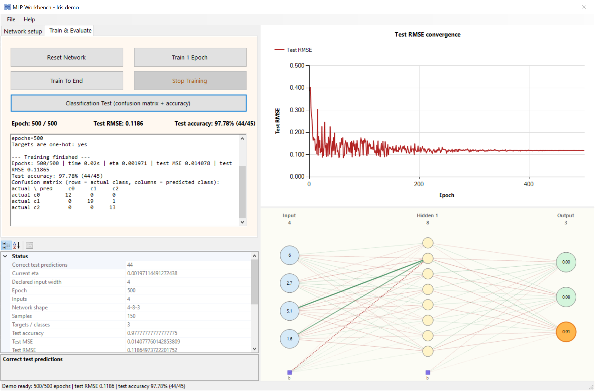

<div align="center">

# 🧠 MLP Workbench

**A portable Windows application that trains a multilayer perceptron on `.cal` data sets, visualises the network, and reports convergence, accuracy, and a confusion matrix.**

[](https://learn.microsoft.com/dotnet/csharp/)
[](https://dotnet.microsoft.com/)
[](https://learn.microsoft.com/dotnet/desktop/winforms/)
[](#network-and-training)
[](#cal-format)
[](#measured-results)
[](#download-and-run)
[](LICENSE)

</div>

---

## Download and run

| Item | Path |
|---|---|
| Portable folder | `release/MlpWorkbench/` |
| ZIP package | `release/MlpWorkbench-win64.zip` |

1. Extract the ZIP or open the portable folder.
2. Double-click **`Launch.cmd`**, or run **`MlpWorkbench.exe`**.
3. Windows 10/11 includes the .NET Framework 4.8 runtime.

The bundle contains the executable, iris and XOR samples, license, and a short `README.txt`.

### Demo mode

```powershell
MlpWorkbench.exe --demo
```

The demo loads `samples/iris.cal`, builds a `4-8-3` network, trains for 500 epochs with seed 42, and opens the window with the convergence chart, network diagram, accuracy readout, and confusion matrix already populated.

```powershell
MlpWorkbench.exe --demo --run 300 --hidden 8,6 --report result.txt
```

Optional flags include `--data`, `--hidden`, `--seed`, `--eta`, `--decay`, `--momentum`, `--ratio`, and `--report`.

---

## Screenshot

<div align="center">
  
  <br>
  <em>Iris demo after 500 epochs: test RMSE curve, live network diagram, 97.78 % test accuracy, confusion matrix, and training status.</em>
</div>

---

## What it does

The application trains a fully connected feed-forward neural network for classification or regression on tabular data.

Features:

- configurable hidden-layer sizes, for example `8` or `8,6`;
- sigmoid activations;
- online backpropagation with one learning-rate application per weight update;
- optional momentum;
- Glorot weight initialisation;
- learning-rate decay per epoch;
- reproducible train/test split and shuffling from a seed;
- min/max input normalisation with a zero-range guard;
- MSE and RMSE on the test split;
- arg-max classification, accuracy, and a `[actual, predicted]` confusion matrix;
- convergence chart;
- network diagram with input, hidden, and output nodes and weighted connections;
- background training with a cooperative **Stop Training** button;
- validation for malformed `.cal` files, wrong column counts, non-finite values, and inconsistent targets.

### Measured results

Iris, `4-8-3`, 105 training / 45 test rows, seed 42, 500 epochs:

| Metric | Value |
|---|---:|
| Test accuracy | **97.78 % (44/45)** |
| Test MSE | 0.014078 |
| Test RMSE | 0.11865 |
| Training MSE | 0.007067 |
| Final learning rate | 0.001971 |

Confusion matrix (`rows = actual`, `columns = predicted`):

```text
             c0  c1  c2
actual c0    12   0   0
actual c1     0  19   1
actual c2     0   0  13
```

The XOR sample reaches 100 % on its two test rows.

---

## Network and training

For each layer `l`, the forward pass is:

```text
v[l][j] = bias[l][j] + Σ w[l][j][i] * x[l-1][i]
x[l][j] = sigmoid(v[l][j])
```

The output error for target `t` and output `o` is:

```text
delta[out] = (o - t) * o * (1 - o)
```

Hidden-layer deltas propagate the weighted output error backwards. Weights are updated once:

```text
w ← w - eta * delta * input
```

Momentum optionally adds a fraction of the previous weight change. `eta` is applied once per update and decays after each epoch.

### Training controls

| Control | Action |
|---|---|
| **Reset Network** | Rebuild weights and re-split the data. |
| **Train 1 Epoch** | Run one epoch and update the chart. |
| **Train To End** | Train until the epoch limit. |
| **Stop Training** | Request a cooperative stop. |
| **Classification Test** | Evaluate the test split and rebuild the confusion matrix. |
| **Network setup** | Choose the number of layers and nodes per hidden layer. |
| **Property grid** | Inspect learning rate, epoch, accuracy, RMSE, and network shape. |

---

## `.cal` format

```text
samples inputs targets inputWidth
x1 x2 ... xN t1 ... tT
...
```

Example header for iris:

```text
150 4 3 4
5.1 3.5 1.4 0.2 1 0 0
4.9 3.0 1.4 0.2 1 0 0
...
```

- `samples`: number of rows.
- `inputs`: number of input columns.
- `targets`: number of target columns.
- `inputWidth`: declared input width retained for format compatibility.
- Targets are numeric. One-hot targets are recommended for classification; the application also accepts non-one-hot numeric targets for regression and warns when classification is not strictly one-hot.

Blank lines and `#` comments are ignored. Rows with the wrong number of columns or non-finite values are rejected with a line/column message.

---

## Project structure

```text
MultilayerPerceptron/
├── Develop an MLP application system that can deal with .cal data sets/
│   ├── MlpWorkbench/                  # application and MLP implementation
│   └── MlpWorkbench.sln
├── samples/
│   ├── iris.cal
│   └── xor.cal
├── release/
│   ├── MlpWorkbench/
│   └── MlpWorkbench-win64.zip
├── docs/screenshots/main.png
├── README.md
└── LICENSE
```

---

## Build from source

**Requirements:** Windows 10/11, Visual Studio 2022/2026 with .NET desktop development, or MSBuild with the .NET Framework 4.8 targeting pack.

```powershell
& 'C:\Program Files\Microsoft Visual Studio\18\Community\MSBuild\Current\Bin\MSBuild.exe' `
  '.\Develop an MLP application system that can deal with .cal data sets\MlpWorkbench.sln' `
  /t:Restore,Build /p:Configuration=Release /v:minimal /nologo
```

Output:

```text
Develop an MLP application system that can deal with .cal data sets\MlpWorkbench\bin\Release\MlpWorkbench.exe
```

Use MSBuild rather than `dotnet build`.

---

## Notes and limitations

- Sigmoid + MSE is retained for continuity with the original model; softmax + cross-entropy would converge faster on classification problems.
- A single train/test split is used; no cross-validation is performed.
- Accuracy varies with the seed and split (roughly 95.56 %–100 % observed on iris).
- The network diagram shows a compact view of the current weights, not every connection label.
- DevExpress dependencies from the original visual layout are not required and have been removed.

---

## References

- Rumelhart, D. E., Hinton, G. E., & Williams, R. J. (1986). *Learning Representations by Back-Propagating Errors.* Nature, 323, 533–536.
- Bishop, C. M. (2006). *Pattern Recognition and Machine Learning.* Springer.
- Goodfellow, I., Bengio, Y., & Courville, A. (2016). *Deep Learning.* MIT Press.

---

## License

MIT License. See [LICENSE](LICENSE).

<div align="center">

Built with 🧠, 📈 and C# by **Benny Lin**  
[GitHub @BennyLinntu](https://github.com/BennyLinntu)

</div>

